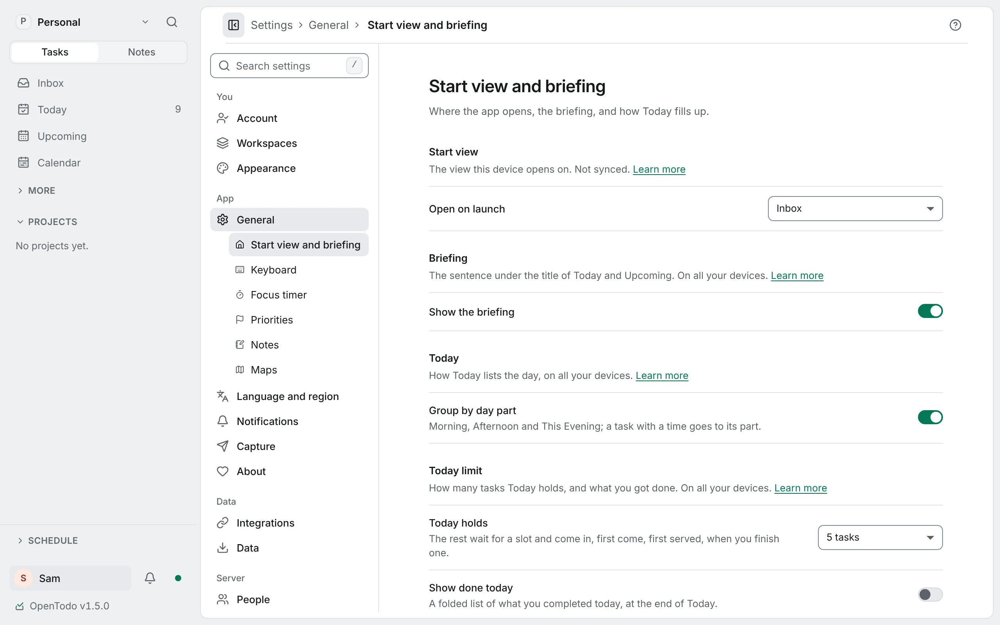
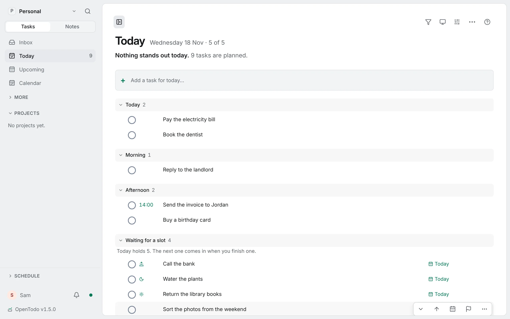

<!-- no-claim -->
A day list grows faster than a day. By mid-morning there are nine things on it, the important ones look the same as the rest, and the list turns into something you scroll past instead of something you finish. This post gives Today an edge: a fixed number of slots, and everything else waiting its turn.

The tasks in the pictures are an example I made for this post, on OpenTodo 1.5.

## Give Today a limit

Open **Settings → General → Start view and briefing** and choose how many tasks **Today holds**: Off, 3, 5, 7 or 10, or Custom for any number from 1 to 20. The limit is yours alone and reaches your other devices. [Set a limit](/docs/today-limit/#set-a-limit)

On the same page, **Group by day part** splits Today into Morning, Afternoon and This Evening. A task with a time goes to the part of its time, so the invoice at 14:00 lands in Afternoon without you placing it. [Turn them on](/docs/day-parts/#turn-them-on)

<!-- no-claim -->

## Five of nine

With a limit on, the line under Today's title reads **5 of 5**: the slots in use and the limit. Today lists that many tasks in its groups, and the others wait in a folded **Waiting for a slot** group at the end, with their count. Nothing is rescheduled, and a full Today never refuses a new task. [Set a limit](/docs/today-limit/#set-a-limit)

The picture at the top is the example day. Five tasks have a slot; the bank, the plants, the library books and the photos wait.

<!-- no-claim -->

## Who gets a slot

Slots are filled first come, first served: first today's focus from the Daily check, then tasks you let in yourself, then tasks from earlier days, oldest first, then the rest by when they were created. A task captured on a full day waits instead of pushing out one you planned, and a priority or a time never reshuffles the slots. [Who gets a slot](/docs/today-limit/#who-gets-a-slot)

So no time is hidden, the folded heading names the next waiting task that has a time or a deadline today. [Tasks with a time today](/docs/today-limit/#tasks-with-a-time-today)

## Finish one, and the next comes in

The waiting group keeps its order, and its first task comes in when you finish one. [Who gets a slot](/docs/today-limit/#who-gets-a-slot)

<!-- no-claim -->
<figure>
<video controls muted playsinline preload="none" poster="/media/blog/a-today-that-stops/finish-one-poster.jpg" width="1280" height="800">
<source src="/media/blog/a-today-that-stops/finish-one.mp4" type="video/mp4">
</video>
<figcaption>Pay the electricity bill is ticked. Call the bank, the first waiting task, comes into Morning, the line still reads 5 of 5, and Waiting for a slot goes from 4 to 3. About 6 seconds, no sound, recorded on OpenTodo 1.5.0.</figcaption>
</figure>

If something waiting can't wait, choose **Take a slot** in its Actions menu (on a phone, a long press). The last task that came in by the usual order goes back to waiting, and **Give back the slot** undoes it. [Take a slot](/docs/today-limit/#take-a-slot)

## Parts of the day

Day parts give the five tasks a shape. Drag a task onto the Morning, Afternoon or This Evening heading, or choose **Day part** in its Actions menu. With day parts on, quick add reads `this morning`, `tomorrow afternoon` or `sat evening`, and `tonight` works either way. [Give a task a part](/docs/day-parts/#give-a-task-a-part) [Type it](/docs/day-parts/#type-it)

## Good to know

- Blocked tasks and the later steps of a sequential project never take a slot, and nor do habits. [Who gets a slot](/docs/today-limit/#who-gets-a-slot)
- **Done today** can list what you finished today at the end of Today, and **Log a win** adds something you did that was never on the list. [Done today](/docs/today-limit/#done-today) [Log a win](/docs/today-limit/#log-a-win)
- Turning day parts off puts Today back as it was. Nothing changes on your tasks. [Turn them on](/docs/day-parts/#turn-them-on)

<!-- no-claim -->
The limit doesn't make the day shorter. It makes the list honest about it: five things you can finish, and a queue that knows what comes next.

<!-- no-claim -->
If this helped, you can [buy me a coffee](https://buymeacoffee.com/pixari) or [sponsor OpenTodo on GitHub](https://github.com/sponsors/pixari). It keeps the project free and without ads.
