<!-- no-claim -->
An assistant that changes your tasks on its own is hard to trust: you find out what it did afterwards. One that only talks leaves the moving to you. From version 1.4, OpenTodo's assistant takes the middle way: it reads, shows and proposes, and you decide.

## Ask, and see the tasks themselves

Press <kbd>Shift</kbd>+<kbd>I</kbd>, or select **Ask** on Today, and type a question the way you would ask a person. The tray under the box says what it carries along, such as **Context: Today**. [Ask, review and undo](/docs/assistant-ask/#open-the-assistant)

Where it saves reading, the answer shows the app's own view instead of a paragraph, such as tasks as rows you can tick off. The views are read from your device, so they stay current and work offline. [Answers that show your tasks](/docs/assistant-answers/#what-answers-can-show)

<!-- no-claim -->

The latest answer may end with up to three next steps, such as **Reschedule the overdue tasks**; selecting one sends it as your message. [Suggested next steps](/docs/assistant-answers/#suggested-next-steps)

## What it can show

An answer can hold up to four of these views, and each one is read-only apart from ticking a task. The model picks the view that fits; under each picture is the kind of question that brings it. [What answers can show](/docs/assistant-answers/#what-answers-can-show)

<!-- no-claim -->

<figure>

<!-- no-claim -->
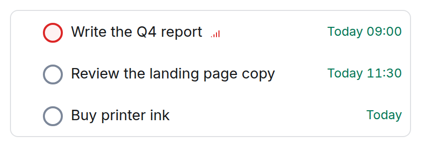

<!-- no-claim -->
<figcaption>Tasks: "What's left for today?"</figcaption>
</figure>
<figure>

<!-- no-claim -->
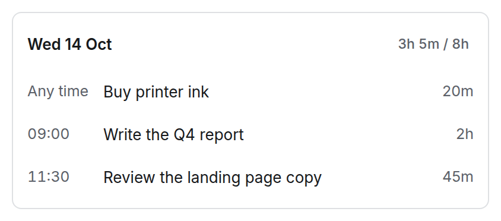

<!-- no-claim -->
<figcaption>A day or a week: "Plan my day."</figcaption>
</figure>
<figure>

<!-- no-claim -->
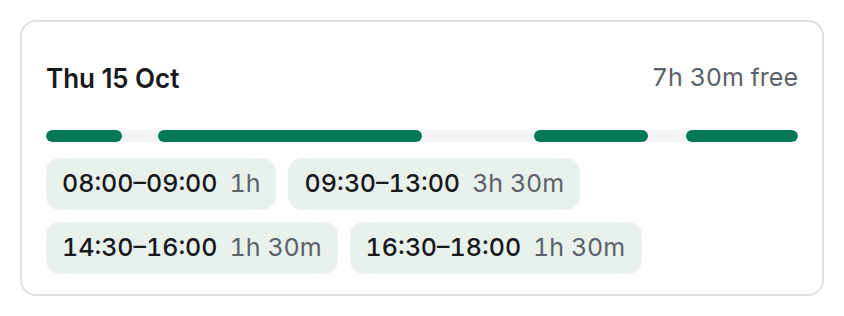

<!-- no-claim -->
<figcaption>Free time: "When am I free for two hours tomorrow?"</figcaption>
</figure>
<figure>

<!-- no-claim -->
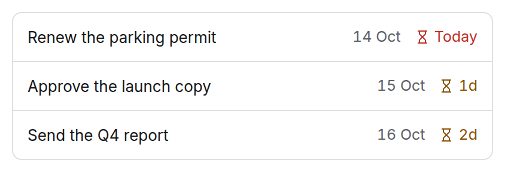

<!-- no-claim -->
<figcaption>Deadlines: "What's due before Friday?"</figcaption>
</figure>
<figure>

<!-- no-claim -->
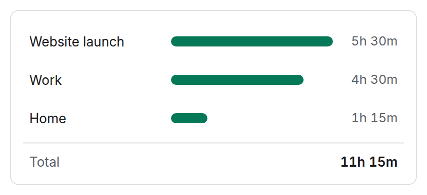

<!-- no-claim -->
<figcaption>Tracked time: "Where did my time go this week?"</figcaption>
</figure>
<figure>

<!-- no-claim -->
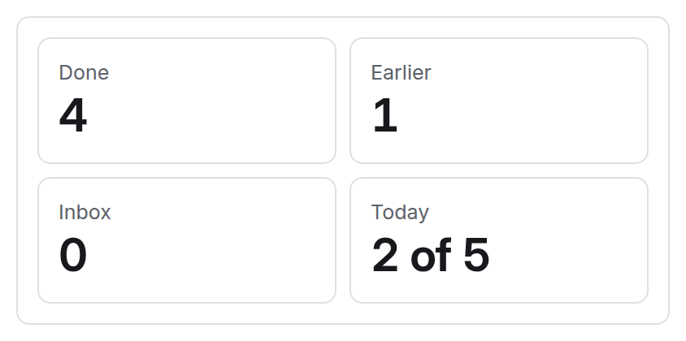

<!-- no-claim -->
<figcaption>Statistics: "How am I doing?"</figcaption>
</figure>
<figure>

<!-- no-claim -->
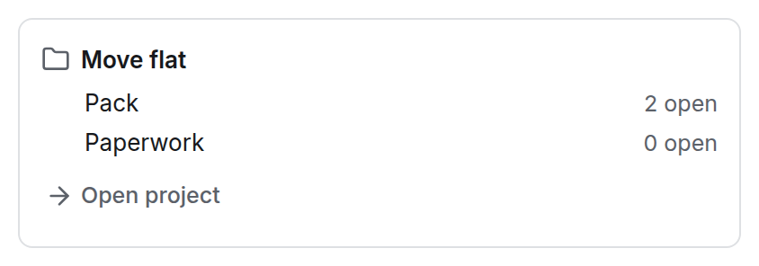

<!-- no-claim -->
<figcaption>A project's outline: "Where am I with the move?"</figcaption>
</figure>
<figure>

<!-- no-claim -->
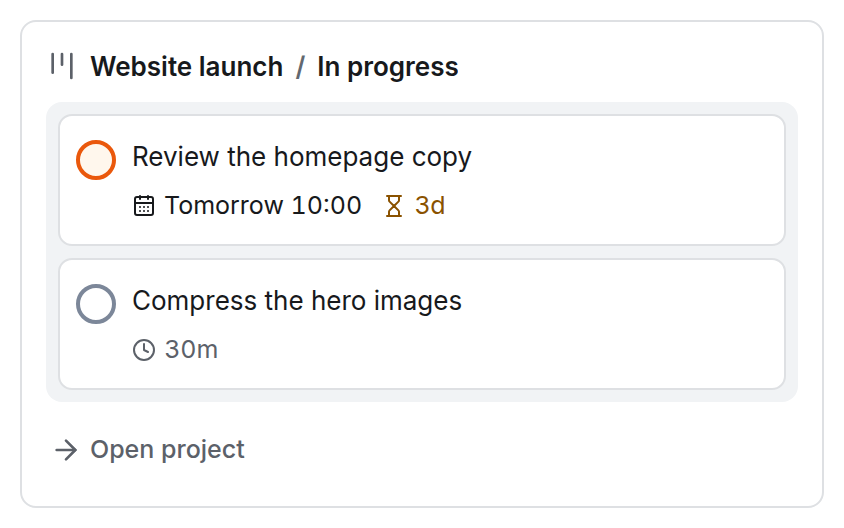

<!-- no-claim -->
<figcaption>A board column: "What's in progress on the website?"</figcaption>
</figure>
<figure>

<!-- no-claim -->
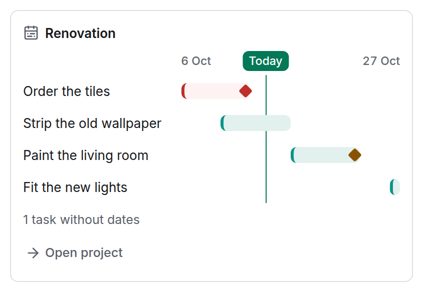

<!-- no-claim -->
<figcaption>A timeline: "Is the renovation on track?"</figcaption>
</figure>
<figure>

<!-- no-claim -->
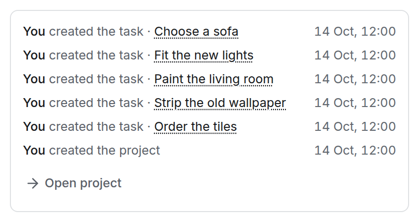

<!-- no-claim -->
<figcaption>Latest activity: "What happened on the renovation?"</figcaption>
</figure>
<figure>

<!-- no-claim -->
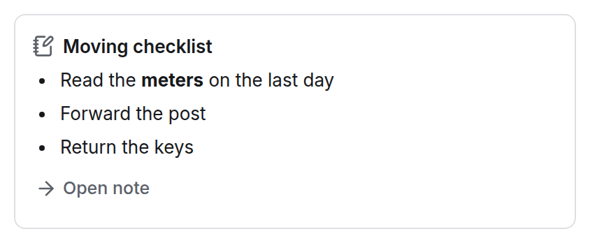

<!-- no-claim -->
<figcaption>A note: "What's in my moving checklist?"</figcaption>
</figure>
<figure>

<!-- no-claim -->
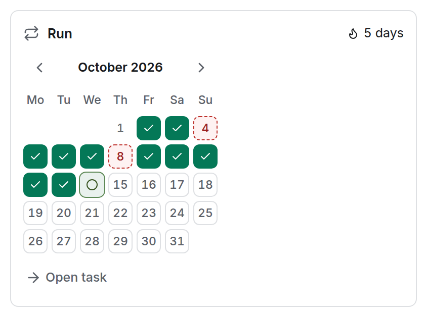

<!-- no-claim -->
<figcaption>A habit: "How is running going?"</figcaption>
</figure>
<figure>

<!-- no-claim -->
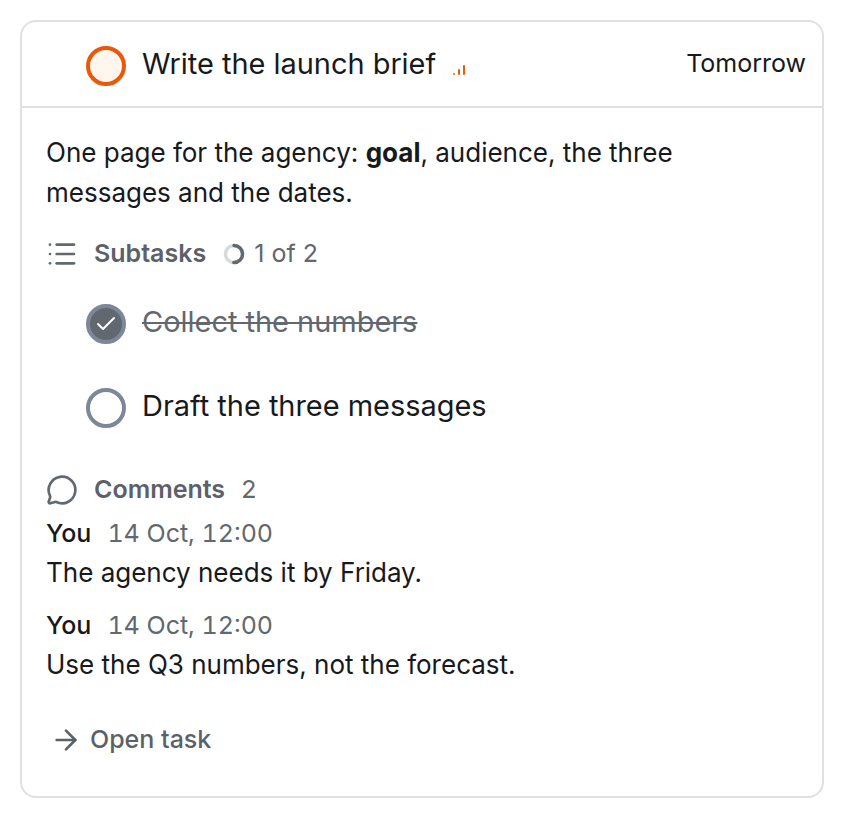

<!-- no-claim -->
<figcaption>A task in full: "Show me the launch brief."</figcaption>
</figure>
<figure>

<!-- no-claim -->
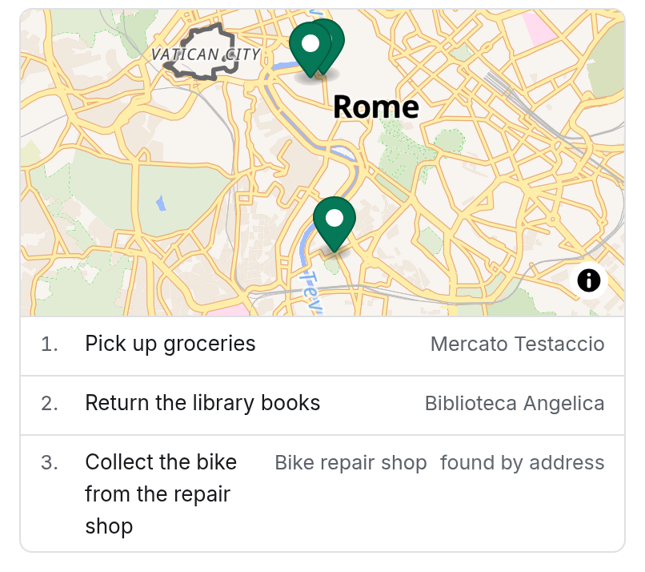

<!-- no-claim -->
<figcaption>Places: "Which errands can I do on one walk?"</figcaption>
</figure>

Errands with a place show on a map, with the same items as a numbered list. A place that has an address but no point on the map is looked up through your server's address search and marked *found by address*; nothing is saved to the task. When there is no map, the block says why above its list: maps are off, nothing could be found by address, or the browser cannot draw maps. Maps can be turned off by you in **Settings → General → Maps** or by the owner for everyone. [Maps and privacy](/docs/locations-and-places/#maps-and-privacy)

## A proposal you can shape

Ask for a change and nothing changes. The answer ends with **Proposed changes**, drawn in the shape of what it touches: moves within one week as a calendar, a new project as an outline, places on a map, with **List** one switch away. [Shape a proposal](/docs/assistant-proposals/#its-own-shape)

Every item has a pencil for its title, dates, time and priority. In the video below the assistant kept the plumber call at 09:30, but the account's memory says calls go after 14:00, so I changed the time. The item is marked **edited**, and what you entered is what applies. In the calendar you can also drag an item to another day, or use <kbd>Alt</kbd>+<kbd>↑</kbd> and <kbd>Alt</kbd>+<kbd>↓</kbd>. [Edit an item](/docs/assistant-proposals/#edit-an-item)

<!-- no-claim -->

While the proposal is open, your next message amends it instead of starting over, and **Before and after** shows each value now and as proposed. Uncheck what you do not want, then **Apply**. [Ask for more](/docs/assistant-proposals/#ask-for-more)

Ask it to give the untimed tasks of a day a time, and the proposal is that day, time-blocked around what is already fixed. [Its own shape](/docs/assistant-proposals/#its-own-shape)

<!-- no-claim -->
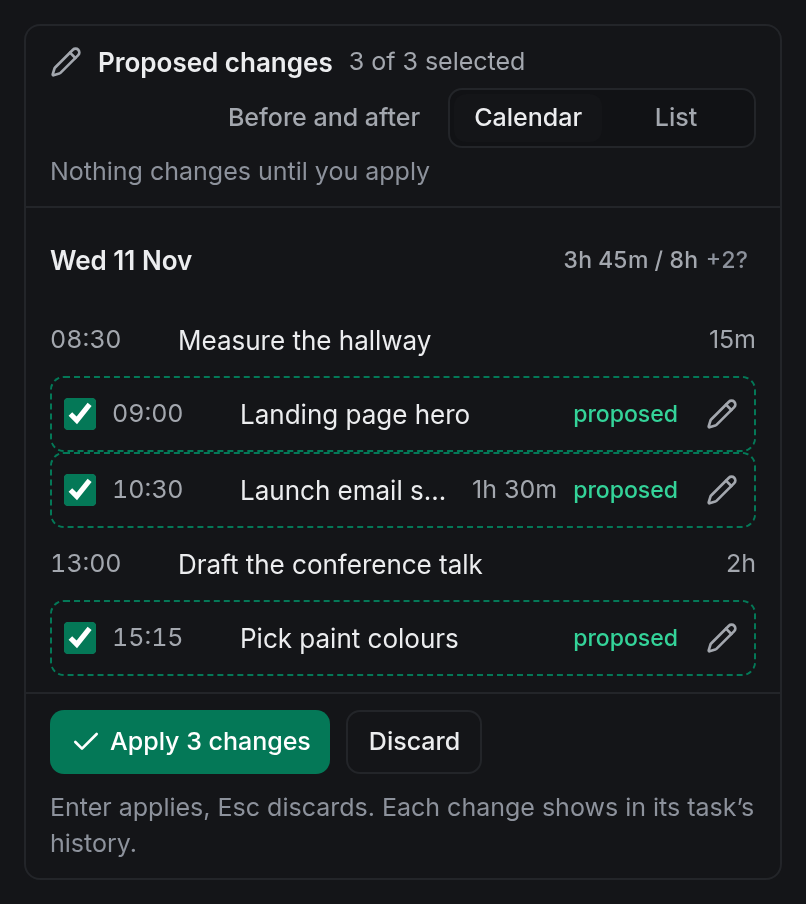

**Undo** puts back every value the proposal changed and moves the tasks it created to the Trash, in one step, also offline. [Undo](/docs/assistant-ask/#undo)

<!-- no-claim -->
<figure>
<video controls muted playsinline preload="none" poster="/media/blog/assistant-asks-first/assistant-poster.jpg" width="1920" height="1080">
<source src="/media/blog/assistant-asks-first/assistant.mp4" type="video/mp4">
</video>
<figcaption>A question in Today, the answer as task rows, a request to move three overdue tasks to Thursday, the proposal as Thursday's calendar, the plumber call moved to 14:30 with the pencil, Apply and Undo. About a minute, no sound, the waits for the model sped up, recorded on a local instance of OpenTodo ahead of 1.4 with Claude Sonnet 5.5.</figcaption>
</figure>

## Where you already are

Some jobs start from their subject. A task's **⋯** menu has **Rewrite this**, **Find a slot** (a time in your free hours over the next seven days that fits its estimate) and **Break this down**; a project's has **What's next?**; Today's has **Brief me**: the agenda, the deadlines and how you are doing. What's next? and Brief me change nothing. [The assistant where you work](/docs/assistant-in-context/)

<!-- no-claim -->

A routine's **Ask AI** step can show the same blocks: a *Morning briefing* puts the day's agenda and the tasks to start with under its line in the Inbox card. The run keeps only which tasks and days, never text. [AI steps](/docs/routines/#ai-steps)

## What it remembers

Memory holds short facts that the assistant keeps to, such as "Works Monday to Thursday": at most 20 lines, in **Settings → Integrations → Assistant → Memory**. The assistant can propose one when you state a fact, but it exists only after you apply it. Nothing is remembered silently. [What the assistant remembers](/docs/assistant-memory/#only-what-you-confirm)

<!-- no-claim -->
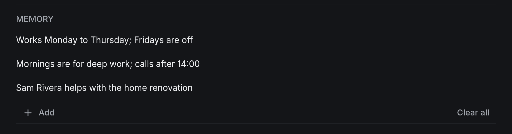

## What is sent, and where it stays

Before your first message the panel names the provider and model and what may be sent: tasks, comments, notes, tracked time, project and label names, the names of people you share with, your memory and your messages. Nothing goes out until you select **Accept and continue**. In a shared project that includes text other members wrote. [Before your first message](/docs/assistant-privacy/#before-your-first-message)

Conversations live only in your browser, never synced or backed up, and the server keeps nothing of a turn after it answered. [Conversations stay on this device](/docs/assistant-privacy/#conversations-stay-on-this-device)

Memory goes to the provider with every message, and nowhere else: MCP clients, API tokens, routines' AI steps and other people never receive it. It syncs to your devices and is end-to-end encrypted on an encrypted account. [Never to anyone else](/docs/assistant-memory/#never-to-anyone-else)

On an encrypted account the server never runs the assistant. If the owner allows it, it runs on your device with your own key, and the server sees only that you agreed. [End-to-end encrypted accounts](/docs/assistant-privacy/#end-to-end-encrypted-accounts)

The owner chooses the model: Anthropic, OpenAI, Google Gemini or any server with the OpenAI-compatible format, such as Ollama or LM Studio on a machine at home. It must support tool use; for the multi-step skills, choose 7B or more. [A local model](/docs/assistant-owner-options/#a-local-model)

## A few ways to use it

<!-- no-claim -->
These are general tips rather than a routine of mine; take the ones that fit.

- **Read before you ask for changes.** A question that only reads sends fewer tool definitions to the model, so it costs less. [Ask and review](/docs/assistant-ask/#ask-and-review)
- **Put your rules in memory.** "Calls after 14:00" once, instead of in every request. [What the assistant remembers](/docs/assistant-memory/)
- **Read the proposal.** In my recording the model misread the clock once and corrected itself in its next answer. The review is there for that. [Safety](/docs/assistant-skills/#safety)

## What it does not do

- It never applies a change by itself, unless you turn on **Small changes without review**: off by default, and limited to completion, dates, priority or labels of at most three tasks. [Small changes without review](/docs/assistant-settings/#small-changes-without-review)
- It cannot change sharing, members, settings or tokens, delete anything permanently, browse the web or send messages. [Safety](/docs/assistant-skills/#safety)
- It is off until the owner of your server turns it on, and off on the public demo. [AI assistant](/docs/assistant/#demo-instance)

## Try it

The assistant comes with OpenTodo 1.4. The owner sets it up in **Settings → Integrations → Assistant** ([Set up the assistant](/docs/assistant-setup/)); then press <kbd>Shift</kbd>+<kbd>I</kbd>. Assistants like Claude Desktop that connect over MCP can show the same task blocks too. [Blocks in the assistant's answer](/docs/mcp/#blocks-in-the-assistants-answer-mcp-apps)
