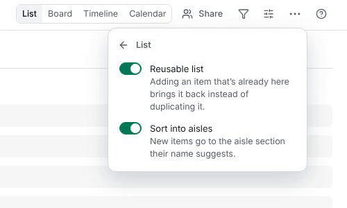
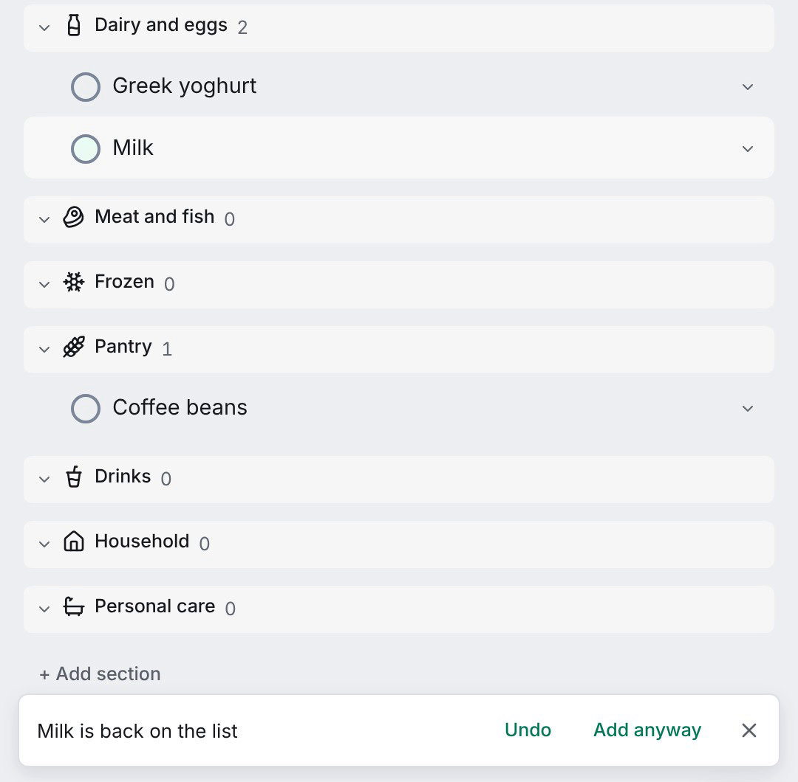

<!-- no-claim -->
A shopping list is the list most households keep, and the one task apps handle worst. The same things come back every week: milk, bread, bananas, coffee. A to-do app treats each of them as a task you finish once. So you add Milk again, and again, and one day there are two of them.

<!-- no-claim -->
OpenTodo 0.21 fixes that with one setting.

<figure>
<video controls muted playsinline preload="none" poster="/media/blog/groceries-that-come-back/groceries-poster.jpg" width="1920" height="1080">
<source src="/media/blog/groceries-that-come-back/groceries.mp4" type="video/mp4">
</video>
<figcaption>A Groceries project becomes a reusable list, its aisle sections appear, new items land in their aisles, Milk is ticked off and added again, and the app says Milk is back on the list. About 30 seconds, no sound, recorded on the public demo.</figcaption>
</figure>

## One switch on the project

Open a project's menu, choose **List…** and turn on **Reusable list**. That is the whole setup. The choice belongs to the project, so everyone you [share it](/docs/sharing/) with gets the same list. Viewers cannot change it. See [Reusable lists](/docs/reusable-lists/) for the details.

## Milk is back on the list

From then on, adding an item that is already there does not create a second one. If you ticked Milk off last Saturday, typing "milk" in [quick add](/docs/quick-add/) reopens the same Milk, in the same section, with its notes and labels, and says **Milk is back on the list**. If Milk is still open, it flashes once and says it is already there. Either message has **Undo** and **Add anyway**, for the week you really want two.

The match is forgiving where it should be and strict everywhere else, as the [reusable lists guide](/docs/reusable-lists/) explains. "CAFE" finds "Café", and a stray space or full stop does not matter. "Mlik" is a new item, because a list that guesses at typos would sooner or later reopen the wrong thing.

Ticked items do not disappear. They wait at the end of the list in a **Got it** group, newest first, on every device of everyone who shares the [list](/docs/reusable-lists/). Untick one there, or simply add it again.

## Sorted the way you walk the shop

Turn on **Sort into aisles** as well, and the list offers nine sections: Produce, Bakery, Dairy and eggs, Meat and fish, Frozen, Pantry, Drinks, Household and Personal care, named in your app language. A new item goes to the aisle its name suggests. "Greek yoghurt" lands in Dairy and eggs, "Sourdough bread" in Bakery, "Coffee beans" in Pantry, as [Sort a list into aisles](/docs/reusable-list-aisles/) describes.

<!-- no-claim -->
The words behind that come from a list built into the app for each language. They never leave your device, and no model guesses at your shopping.

The sections are yours. Rename Dairy and eggs to "Fridge" and items still find it. Move "Oat drink" to Drinks once and it goes back there every time it returns. An item the word list does not know goes where [quick add](/docs/quick-add/) would put it anyway, so nothing is ever lost in a section you did not expect.

## Two phones, one Milk

Two people in the same shop, both offline, both add eggs. When the phones [sync](/docs/offline-and-sync/), the list keeps one Eggs and moves the other to the [Trash](/docs/trash-and-history/). Every device picks the same one, so the list settles without anyone choosing, and the project's activity says "merged a duplicate" in case you want it back.

An item with something of its own is never merged away: notes, subtasks, comments, attachments, [reminders](/docs/reminders/) or a repeat. Then both stay, and you decide.

## It works without a connection

The matching happens on your device, so a reusable list works [offline](/docs/offline-and-sync/), in the car park with one bar of signal. On an account with [end-to-end encryption](/docs/e2ee/) the server cannot read item names, so the matching stays on your devices, and a duplicate that arrives through the API is merged by the next device that sees it.

The [API](/docs/api/), the `ot` [command line](/docs/cli/) and AI assistants connected over [MCP](/docs/mcp/) reuse items in the same way, so "add milk to groceries" from a terminal or an assistant reopens the same Milk.

## Try it

<!-- no-claim -->
Reusable lists are in OpenTodo 0.21. On your own server, open your groceries project and flip the switch; on the [demo](https://demo.open-todo.app) you can try it in a private sandbox without installing anything. The same setting suits the pharmacy run, a packing list or the things the bathroom always runs out of.

<!-- no-claim -->
If a word ends up in the wrong aisle in your language, tell me in an [issue](https://github.com/OpenTodoApp/OpenTodo/issues). The word lists are part of the app, and fixing one is a small pull request.
