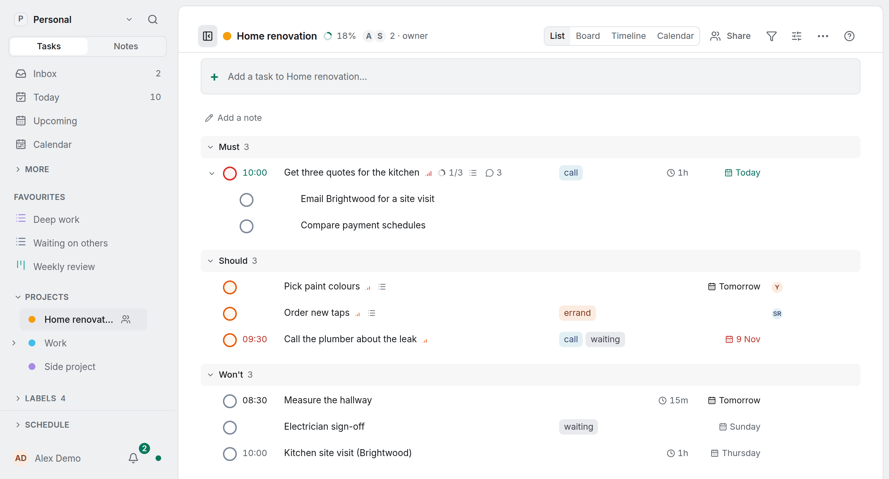

<!-- no-claim -->
OpenTodo 1.4.0 is out, with 1.4.1 right behind it on the same day. It is the release of notes and the assistant. Notes stop being a page you find under More and become half of the app; the assistant learns to answer with your tasks instead of paragraphs about them. Here is what changed.

## Notes have a side of their own

A **Tasks | Notes** control under the workspace name switches the sidebar to your notes: All notes, your pinned notes and the ones you changed last. Opening a note shows that side, opening a task shows Tasks again, and <kbd>g</kbd> <kbd>e</kbd> still opens Notes. See [Tasks and Notes in the sidebar](/docs/notes/#tasks-and-notes-in-the-sidebar).

The Notes page is one line per note: its kind, title, project, labels and when it last changed. Pinned notes come first, the rest under Recent. A standalone note gets a project and labels below its text, and there are no folders: projects and labels organise notes. See [The list](/docs/notes/#the-list) and [Writing a note](/docs/notes/#writing-a-note).

The search field takes tokens that turn into chips: `in:Renovation`, `@errand`, `kind:note`, `linked:Trip`, `orphan` for the notes nothing links to, `pinned`, and `changed:<7d`. They replace the old Source, Project and Label filters. When nothing matches what you typed, Enter creates a note with that title, in the project of an `in:` chip. See [Narrow notes with tokens](/docs/note-tokens/) and [Start a note from the search field](/docs/notes-home/#start-a-note-from-the-search-field).

<!-- no-claim -->

## Links, and what links back

Type `[[` in any note, a task's, a project's or a standalone one, and pick a note, task or project, or create a new note on the spot. A link always shows the current title, so renaming never breaks it. At the end of a note, **Linked references** lists every note that links there, with the line around the link. See [Link notes, tasks and projects](/docs/note-links/) and [Linked references](/docs/note-links/#linked-references).

**Show connections**, in the menu of anything with a link, draws one item in the middle, what it links with on an inner ring and their links on an outer ring, and works from the keyboard. See [See an item's connections](/docs/note-connections/).

Links are stored as plain Markdown, so older apps keep them, and they are worked out on your device: offline, and with end-to-end encryption the server never learns which notes link where. See [Links in Markdown](/docs/note-links/#links-in-markdown).

## The graph of all notes

The Notes page has a second mode, **Graph**: every note of the workspace and the tasks and projects they link to, as one picture that fills the page. Pan and zoom, point at a note to light its neighbours, click it to open it beside the graph, and double-click to centre it with a depth of one to three links. **Find a note** moves to a note by its title, and the search field's chips dim everything outside a topic without moving anything. See [See all your notes as a graph](/docs/notes-graph/).

<!-- no-claim -->

The layout is the same every time and kept on the device, so a new note appears beside its links while everything else stays put. The List is its equivalent for screen readers. See [Private and offline](/docs/notes-graph/#private-and-offline).

## The assistant

The assistant now answers with the app's own views: tasks as rows you can tick off, a planned day, a board column, a map. You can edit a proposal before you apply it, it remembers short facts you tell it, it is one click away in the menus where you work, routines' AI steps show the same blocks, and Claude, ChatGPT and VS Code can show your tasks the way OpenTodo draws them through MCP Apps. A question that only reads costs about a third less. See [Answers that show your tasks](/docs/assistant-answers/) and [Blocks in the assistant's answer](/docs/mcp/#blocks-in-the-assistants-answer-mcp-apps).

<!-- no-claim -->
That deserves more than a paragraph: [An assistant that asks first](/blog/assistant-asks-first/) has the full tour.

## Also new

- **Name your priorities.** Settings → General → Priorities gives the four levels your own words, such as *Must*, *Should*, *Could* and *Won't*. They show wherever a priority does; `p1` to `p4` stay the syntax. See [Name your priorities](/docs/priorities/).
- **Order by urgency.** Display options → Order by → Urgency puts what needs you first, from its date, deadline, priority, the tasks waiting for it and more. Each row shows its score, and **Why here?** gives the breakdown. See [Order by urgency](/docs/urgency-order/).
- **Progress rings.** A task with subtasks shows a small ring before its count, and a project shows its progress next to its title. See [Break a task into subtasks](/docs/notes-and-subtasks/#break-a-task-into-subtasks).
- **Print a list.** <kbd>Ctrl</kbd>+<kbd>P</kbd> on a list prints it clean, black on white, with an empty circle to tick by hand; **Print…** in the list's menu does the same. See [Print a list](/docs/print-a-list/).
- **Display options on Today, Upcoming and the Inbox**, with grouping, order and nested subtasks. See [Arrange Today, Upcoming and the Inbox](/docs/arrange-built-in-views/).
- **Calmer Focus and Close the day.** Focus shows the task, its next subtask and the time left, with the rest in the **⋯** menu; Close the day is three steps and one Undo. See [Focus](/docs/focus/#the-screen) and [Close the day](/docs/method/rhythms/#close-the-day).
- **The Loop home's next step.** A **Next step** card names one move and why, with one button. See [How prominent it is](/docs/method/overview/#how-prominent-it-is).

<!-- no-claim -->

The server is also ready for the sign-in of a native OpenTodo app that is coming: it signs in through your phone's own sign-in sheet, with passwords, two-factor, passkeys and single sign-on, and shows up with your sessions in Settings. See [App sign-in](/docs/api/#app-sign-in).

## Fixes worth naming

- **Completing a task in a long list is fast again.** In a 2,000-task list it had become about four times slower; it is back under its budget. See [Performance budgets](/docs/performance/#budgets).
- **Nothing moves the list under your finger.** The "n selected" bar floats over the bottom of the screen, and notices are toasts in the corner. See [Bulk actions](/docs/bulk-actions/).
- **The iPhone app's widget and reminders work.** The App Store and TestFlight builds kept the web app from reaching the phone; reminders, the Today widget, the share sheet and Face ID unlock now work. See [The iOS app](/docs/ios-app/).

## Upgrading

<!-- no-claim -->
Nothing to do: the database migrates by itself, and every new value stays readable by 1.x apps. Pull the new image and restart, for example `docker compose pull && docker compose up -d` with the `stable` or `1` tag. See [Updating](/docs/self-hosting/docker/#updating).

<!-- no-claim -->
1.4.1 is the same as 1.4.0 for a server. It publishes what the 1.4.0 release left out: the iPhone build for TestFlight and the App Store, and the Claude and Obsidian plugins. Upgrading from 1.4.0 is optional.

OpenTodo for iPhone and iPad is now in the App Store, as a first release: it connects to your server and adds reminders on the phone, the share sheet, a Today widget and Face ID unlock. On Android, the app is available from the release page on GitHub for now; Google Play and F-Droid are on the way. See [Install on your phone](/docs/install-phone/).

## Thank you

<!-- no-claim -->
Ioannis Kechagias (Kechos23) wrote two of the changes in this release: the tinted label chips, and renaming, recolouring and choosing a project's icon from its sidebar menu. Thank you also to n3uron4, who asked for display options on Today, Upcoming and the Inbox, Siflei, whose two requests made routines work in one workspace and gave their conditions a "not", and justinsteven, whose reports made the iPhone app's first screen clearer and stopped the selection bar from pushing the list down.

The full list of changes is in the [release notes](/changelog/#v1-4-0) and on [GitHub](https://github.com/OpenTodoApp/OpenTodo/releases/tag/v1.4.0).
