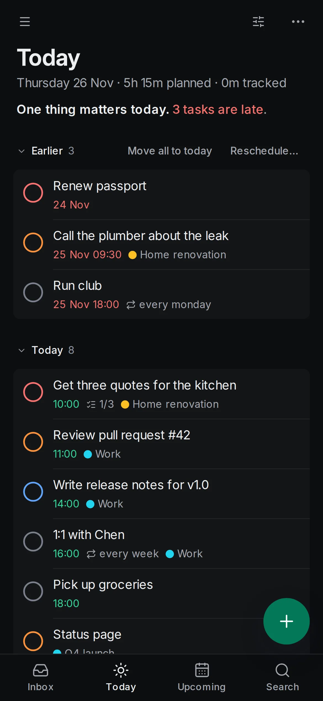
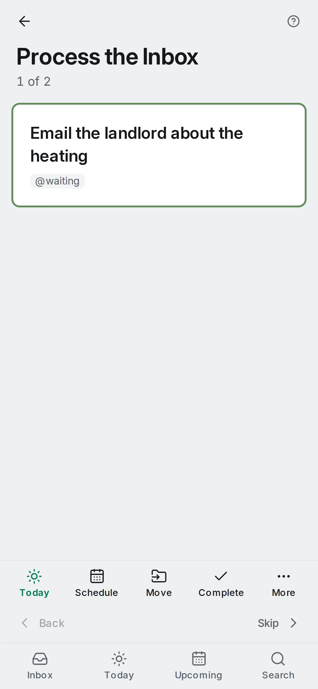

<!-- no-claim -->
On a phone, OpenTodo now shows screens that were designed for a phone. The task lists and the task page arrived with 1.9.0 on 26 November 2026. 1.10.1 brings the rest of the app along: the calendar, Process the Inbox, a board, a project's timeline and the smaller pages.

## Why

Until now a phone showed the same screens as a computer, rearranged to fit. Everything was there and it worked, but it read like a website on a small screen: controls sized for a pointer, and explanations only a mouse could reach. So I wrote the screens again, starting from what a thumb does. See [The earlier screens](/docs/phone-screens/#the-earlier-screens).

## Lists you tap, tick and swipe

Every task list opens in the phone design: the Inbox, Today, Upcoming, Anytime, Someday, a label, a project as a list and the others. They show the same tasks, groups and order as before. Each group is one card, and under a task's title one line holds its time or date, subtasks, repeat and project. See [The task lists](/docs/phone-screens/#the-task-lists).

Tap a task to open it and its circle to complete it, with **Undo** as before. Swipe right to complete, left to choose a date. Hold a task and lift your finger for its menu; hold and move to put it somewhere else in a list you order by hand. See [Tap, swipe, hold](/docs/phone-screens/#the-task-lists).

<!-- no-claim -->

<figure>

<!-- no-claim -->
![Today on a phone in the light theme. A bar with the menu button, the display options and the menu, then the title Today, the date and a briefing that says three tasks are late. Under Earlier, one card holds Renew passport, Call the plumber about the leak and Run club. Under Today, a second card holds Get three quotes for the kitchen at 10:00 with one of three subtasks done, Review pull request #42, Write release notes for v1.0, 1:1 with Chen and Pick up groceries, each with its circle and one line with its time, repeat and project. The tab bar and a round add button are at the bottom.](./today.webp)

<!-- no-claim -->
<figcaption>Today, in light.</figcaption>
</figure>
<figure>

<!-- no-claim -->

<!-- no-claim -->
<figcaption>And in dark.</figcaption>
</figure>

Every screen has the same bar: the menu button or **Back**, the page's own controls and its menu, then the title, large. The add button adds to the list on screen. See [New phone screens](/docs/phone-screens/).

## A task as a page

A task opens as a page. The title and the note come first. What the task has is a list of rows, such as its date, project, priority and labels, and a tap on a row changes it. What it does not have yet is a row of buttons under them: **Deadline**, **Reminder**, **Repeat** and the rest. See [The task page](/docs/phone-screens/#the-task-page).

The **Do** row opens a sheet made for a phone: **Today**, **Tomorrow**, **This weekend** and **Next week** with the date each one means, then a month with days large enough for a thumb, then the time of day. A tap on a choice or a day sets the date and closes the sheet. The same sheet opens when you swipe a task to the left in a list. See [Choosing a date](/docs/phone-screens/#choosing-a-date).

<!-- no-claim -->

<figure>

<!-- no-claim -->

<!-- no-claim -->
<figcaption>A task's facts as rows, the missing ones as buttons.</figcaption>
</figure>
<figure>

<!-- no-claim -->

<!-- no-claim -->
<figcaption>The date sheet behind the Do row.</figcaption>
</figure>

## The calendar and Process the Inbox

In **Week**, **Month** and **Plan**, a task is the row of the lists: tap to open, the circle completes, swipe left to move it to another day. See [The calendar](/docs/phone-screens/#the-calendar).

In Process the Inbox, the decisions are a bar at the bottom of the screen, always in the same place: **Today**, **Schedule**, **Move**, **Complete** and **More**, then **Back** and **Skip**. Swipe the card right to complete the task, left to schedule it. See [On a phone](/docs/process-the-inbox/#on-a-phone).

<!-- no-claim -->

<figure>

<!-- no-claim -->

<!-- no-claim -->
<figcaption>Week, as rows.</figcaption>
</figure>
<figure>

<!-- no-claim -->

<!-- no-claim -->
<figcaption>Process the Inbox, with its decisions at the bottom.</figcaption>
</figure>

## A board and a timeline by touch

On a board, hold a card and keep it at the left or right edge: the next column slides in under it, one column at a time, so you can drop the card in a column that was out of sight. See [Move cards between columns](/docs/sections-and-boards/#move-cards-between-columns).

On a project's timeline, each task's name sits on its own line above its bar. Tap a name or a bar to open the task. Press and hold a bar until it lifts, then move: the middle moves the task, and a finger's width at either end sets the start or the deadline. See [A project on a timeline](/docs/project-timeline/).

<!-- no-claim -->

<figure>

<!-- no-claim -->

<!-- no-claim -->
<figcaption>A board opens on its first column.</figcaption>
</figure>
<figure>

<!-- no-claim -->

<!-- no-claim -->
<figcaption>A timeline: names above, bars a finger can hold.</figcaption>
</figure>

## Explanations on a tap

A word, a time or a badge that explained itself in a tooltip could only be read under a mouse. On a phone or tablet it now opens on a tap, and a tap elsewhere closes it: the exact time behind "3 h ago", what a role means, a day's capacity in the calendar. The [release notes](/changelog/#v1-10-0) list them.

Updates, Habits, Notes, Routines and Statistics were gone through the same way. A tap on a row of Updates opens what it is about, and the Notes page's menu begins with **From template…**. See [Starting a note from one](/docs/note-templates/#starting-a-note-from-one) and the [release notes](/changelog/#v1-10-0).

## Going back

If you prefer the earlier screens, open **Settings → Appearance → Theme and density** on the phone and turn off **New phone screens** at the end of the page. It takes effect at once. The choice is kept on that phone and is not synced, so your other devices are not affected. The earlier screens are kept for now, and the switch with them. See [The earlier screens](/docs/phone-screens/#the-earlier-screens).

## What is not done

**Day** in the calendar is still the time grid it was. What changed there is small: hold a block near an edge to change its length. See [The calendar](/docs/phone-screens/#the-calendar).

The screens are checked by an automated run in a browser at phone widths. That is not the same as many hands on many phones, and I do not know yet how they hold up across them. See [Tests and checks](/docs/contributing/tests-and-checks/).

## Getting it, and telling me

The phone screens come with the server: back up, replace the image or the binary and restart. The Android and iPhone apps show what the server serves, so no new app is needed. See [Updating](/docs/self-hosting/docker/#updating), [The Android app](/docs/android-app/) and [The iOS app](/docs/ios-app/).

If something was easier before, or does not fit your phone, tell me with **Feedback and problems** in the menu. See [Tell us](/docs/phone-screens/#tell-us).

<!-- no-claim -->
The full list of changes is in the [release notes](/changelog/).
