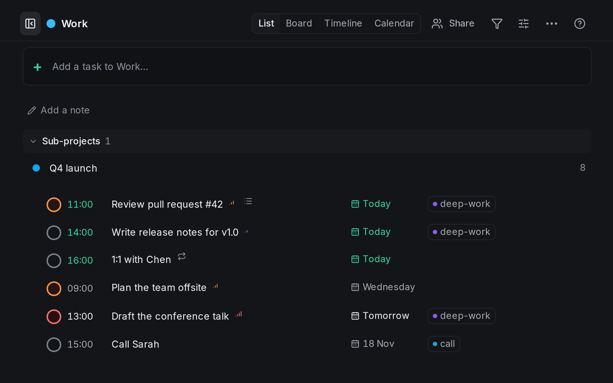
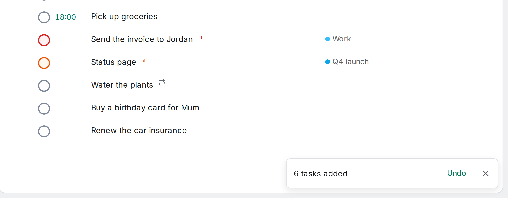

<!-- no-claim -->
A task arrives while you are doing something else. Someone mentions a call, a bill turns up, a colleague asks for an invoice. If writing it down means a form with a date picker, a project menu and a label field, you put it off, and then it is gone. The first post of this series is about the one habit that makes the rest possible: getting things out of your head in the time it takes to say them.

## One line, the way you would say it

Press <kbd>q</kbd> in any list and type a line. OpenTodo picks out the date and time, the project, labels, priority and estimate, and keeps the rest as the title. See [Quick add syntax](/docs/quick-add/).

```
Call Sarah next Wednesday at 3pm #work @call +30m
```

The picture at the top shows that line in Today. Each part it understood becomes a chip under the box: 18 Nov 15:00, the project Work, the label call and an estimate of 30 minutes. The preview says what will be saved as the title, *Call Sarah*. If there is no chip, the words stay in the title. [Preview chips](/docs/quick-add/#preview-chips)

The tokens are short and the same in every language: `#` for a project (a unique start of its name is enough), `@` for a label (a new name creates the label), `p1` to `p4` for priority and `+30m` or `+2h` for an estimate. [Tokens](/docs/quick-add/#tokens-any-language)

Dates are everyday words: `tomorrow`, `fri`, `in 2 weeks`, `3 Feb`, `at 9`, `noon`. `next Wednesday` follows your week: typed on Monday 9 November, it skips the Wednesday two days away, which is still this week, and means 18 November. [Dates and times](/docs/quick-add/#dates-and-times)

On a phone, the add sheet shows the same chips, with buttons under them that start a date, priority, label, estimate or project for you. The sheet stays open after you add a task, so the next one can follow straight away. [In the command bar](/docs/quick-add/#in-the-command-bar)

<!-- no-claim -->


## Where it lands

Press <kbd>Enter</kbd>. The line was typed in Today, but it named a project and a date, and what the line says wins over the view you are in: the task goes to Work, on 18 November at 15:00. Anything the line leaves out comes from the view, so a plain line typed in Today is due today, and one typed in a project goes into that project. [Views and defaults](/docs/quick-add/#views-and-defaults)

<!-- no-claim -->


## A whole list at once

Lists rarely arrive one task at a time. They come as the end of a meeting, a message from someone at home, or a note you wrote on the train. Copy the lines and paste them into an empty quick add. OpenTodo asks first, showing the first five lines as they will be titled. [Paste a list](/docs/quick-add/#paste-a-list)

<!-- no-claim -->


**Add 6 tasks** makes one task per line, in order; **Paste as one line** joins them instead. List markers such as `-`, `1.` or `[ ]` are dropped, and each line is read like one you typed: the dentist goes to next Monday, the bank to tomorrow at 10:00, the invoice to Work with priority 1. Lines that set nothing are due today, because the paste was in Today. [Paste a list](/docs/quick-add/#paste-a-list)

All six are saved together, offline too, and a note says *6 tasks added* with **Undo**, which removes all of them in one step. [Paste a list](/docs/quick-add/#paste-a-list)

<!-- no-claim -->


<!-- no-claim -->
<figure>
<video controls muted playsinline preload="none" poster="/media/blog/write-it-the-way-you-say-it/quick-add-poster.jpg" width="1920" height="1080">
<source src="/media/blog/write-it-the-way-you-say-it/quick-add.mp4" type="video/mp4">
</video>
<figcaption>The line typed into quick add, its chips appearing as it is typed, then six lines pasted into Today, the question, and the note with Undo. About 22 seconds, no sound, recorded on a demo instance of OpenTodo 1.3.0.</figcaption>
</figure>

## A few ways to use it

<!-- no-claim -->
These are general tips rather than a routine of mine; take the ones that fit.

- **Empty your head first, sort later.** Type lines into the Inbox without any details, and decide what each one is when you sort the Inbox. [Process the Inbox](/docs/process-the-inbox/)
- **Keep a word as a word.** A film called *Next Friday* or a name like May would be read as a date. Put the words in double quotes, or select the `×` on the chip. [Preview chips](/docs/quick-add/#preview-chips)
- **Paste the end of a meeting.** The actions from the minutes become tasks in the order they were written, and one Undo takes them back if you pasted the wrong part. [Paste a list](/docs/quick-add/#paste-a-list)
- **Use the same line elsewhere.** The title field of the capture screen, where shared pages arrive, is a quick add line too, so `tomorrow #work` works there. [Capturing pages](/docs/capture/)

## What it does not do

- It reads one date per line. When a line has two, the first counts and the second stays in the title; the same goes for a second time, project or priority. [Dates and times](/docs/quick-add/#dates-and-times)
- Bare numbers are never times: `Buy 3 apples` stays as typed. Write `at 3`, `3pm` or `15:00`. [Dates and times](/docs/quick-add/#dates-and-times)
- An unknown `#name` stays in the title unless you pick **Create project** from the list. [Not understood](/docs/quick-add/#not-understood)
- A paste into a box that already holds text goes in as text, and a single paste adds up to 100 lines; for a longer list, use Import. [Paste a list](/docs/quick-add/#paste-a-list)
- The server and the REST API do not read lines. The `ot` command-line tool does, with `ot add --natural`. [Not understood](/docs/quick-add/#not-understood)

## Try it

Open the [demo](https://demo.open-todo.app), press <kbd>q</kbd> and type the way you would say it. The full list of words quick add understands is on [Quick add syntax](/docs/quick-add/), and how dates behave once a task has one is in [Dates and times](/docs/dates-and-times/). For the short version, with the steps on one page, see the how-to [Add a task with its date, project and label in one line](/how-to/add-a-task-with-everything-in-one-line/).

<!-- no-claim -->
Next week: five minutes for the Inbox, and sorting what you captured one key at a time.
